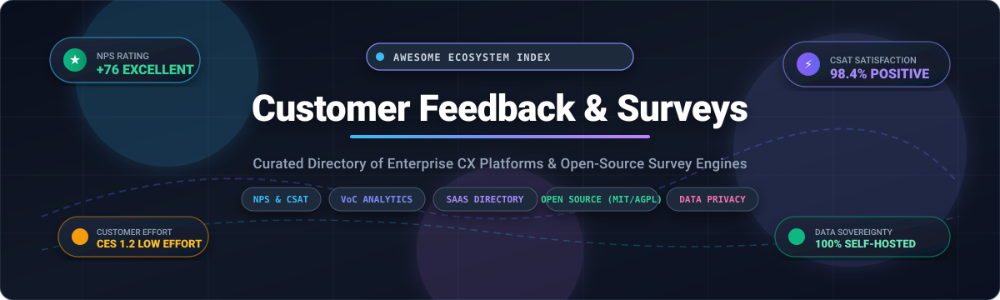

# Awesome-Customer-Feedback-Surveys

  

## Top Customer Feedback Surveys Ecosystem

**Curated List of SaaS Products & Open-Source GitHub Projects**  
*The ultimate index of Customer Feedback Software, Online Survey Builders, NPS/CSAT Measurement Platforms, and Experience Management (CXM) Tools.*  

**Last updated: March 2026**

Welcome to the definitive directory for **Customer Feedback & Surveys**. Whether you are building product-market fit (PMF) surveys, orchestrating enterprise Customer Experience (CX) programs, measuring Net Promoter Score (NPS) and Customer Satisfaction (CSAT), or self-hosting privacy-first open-source survey infrastructure, this repository curates the top tools in the ecosystem.

### 🔍 Key Metrics & Survey Methodologies Supported
- **NPS (Net Promoter Score)**: Measure long-term customer loyalty and likelihood of recommendation (-100 to +100).
- **CSAT (Customer Satisfaction Score)**: Evaluate immediate customer contentment after specific transactions or interactions (1 to 5 scale).
- **CES (Customer Effort Score)**: Gauge how easy or difficult it was for customers to resolve an issue or accomplish a task.
- **PMF (Product-Market Fit / Sean Ellis Test)**: Track the percentage of users who would be "very disappointed" if your product disappeared (>40% benchmark).
- **Voice of Customer (VoC) & In-App Microsurveys**: Trigger targeted contextual feedback directly inside web and mobile apps.

---

## 📑 Table of Contents

- [📊 Sector Overview & Market Dynamics](#-sector-overview--market-dynamics)
- [☁️ SaaS / Hosted Platforms](#️-saas--hosted-platforms)
- [🐙 Open-Source GitHub Projects](#-open-source-github-projects)
- [🤝 How to Contribute](#-how-to-contribute)
- [⚠️ Disclaimer](#️-disclaimer)

---

## 📊 Sector Overview & Market Dynamics

The global customer feedback and online survey software market is estimated at **$4.6B to $5.5B** and projected to exceed **$12B+ by 2032**, expanding at a ~14–16% CAGR driven by automated CX analytics and continuous digital sentiment tracking. The sector exhibits a **barbell market structure**: it is **moderately to highly fragmented at the entry and mid-market level** with hundreds of low-barrier form and widget tools, yet **heavily concentrated at the enterprise experience tier** where a small oligopoly of giants (e.g., Salesforce, Qualtrics, Medallia) captures the majority of enterprise contract value.

---

## ☁️ SaaS / Hosted Platforms

| 🏢 Platform | 💰 Company Size (Valuation / Revenue) | 📝 Description | 🏷️ Starting Pricing | 🎁 Free Tier / Trial Limits |
| :--- | :--- | :--- | :--- | :--- |
| **[Salesforce Survey and Feedback Management](https://www.salesforce.com/)** | ~$280B+ Market Cap / ~$34.9B ARR | Native Salesforce survey tool integrated with Service Cloud and Experience Cloud. Enables NPS, CSAT, and custom feedback collection with Einstein AI analytics. | Starts at $300/mo (add-on pack for 1,000 responses); Feedback Management Starter edition from $12,000/mo | No permanent free tier; 30-day free trial of Salesforce CRM includes a pool of 300 survey responses across the org |
| **[Qualtrics CustomerXM](https://www.qualtrics.com/)** | $12.5B Valuation (Silver Lake buyout) / ~$1.5B ARR | Enterprise experience management platform for customer feedback, NPS, and predictive analytics. Widely used for CX programs across industries. | Starts at $420/mo ($5,040/yr billed annually) for entry CoreXM research; CustomerXM enterprise packages start from ~$15,000/yr | Free forever basic tier limited to 1 active survey, 15 questions per survey, and 100 lifetime responses (no export or automations); sales-guided 30-day trial for research |
| **[Medallia](https://www.medallia.com/)** | $6.4B Valuation (Thoma Bravo buyout) / ~$600M+ Revenue | Enterprise experience management platform for customer, employee, and product feedback. Features AI-powered text analytics and closed-loop actioning. | Enterprise deployments start around $25,000 - $50,000/yr (priced per Experience Data Record / EDR volume tiers) | No permanent free tier; no public self-serve free trial (custom sales-guided 30 to 60-day POC available upon enterprise qualification) |
| **[SurveyMonkey Enterprise](https://www.surveymonkey.com/)** | $1.5B Valuation (STG buyout) / ~$480M Revenue | Enterprise survey platform with advanced logic, A/B testing, and integrations. Supports NPS, CSAT, and 360-degree feedback. | Starts at $39/mo ($468/yr billed annually) for Advantage individual plan, or $25/user/mo (min 3 users, $900/yr) for Team Advantage | Free forever Basic plan limited to 10 questions per survey and 40 viewable responses per survey (unlimited surveys, no data export) |
| **[UserTesting](https://www.usertesting.com/)** | $1.3B Valuation (Thoma Bravo buyout) / ~$200M+ Revenue | Human insight platform combining surveys with video feedback and usability testing. Strong for product research and UX validation. | Starts at $12,000/yr (~$1,000/mo billed annually) for core platform access with test-credit consumption blocks | No permanent free tier; 14-day sales-gated evaluation trial limited to 1-2 sample video testing sessions upon qualification |
| **[InMoment](https://inmoment.com/)** | ~$1.0B Valuation (Press Ganey acquisition) / ~$150M+ Revenue | Experience management platform with survey, analytics, and CX program management. Focuses on actioning insights across the organization. | CoreCX modules start at ~$50 - $100/user/mo; enterprise customer experience deployments start from ~$15,000/yr | No permanent free tier; 30-day free trial available for CoreCX microsurveys (restricted to single feedback stream) |
| **[Typeform](https://www.typeform.com/)** | $935M Valuation (Series C) / ~$100M ARR | Conversational form and survey builder known for engaging, mobile-friendly experiences. Features logic jumps, hidden fields, and integrations. | Starts at $28/mo ($336/yr billed annually) or $39/mo billed monthly for Basic plan | Free forever plan limited to 10 responses/month, 1 user seat, and unlimited form creation |
| **[QuestionPro](https://www.questionpro.com/)** | ~$350M Est. Valuation / ~$50M Revenue (Bootstrapped) | Comprehensive survey platform with advanced logic, reporting, and 360-degree feedback. Includes NPS and customer experience modules. | Starts at $99/user/mo ($1,188/yr billed annually) for Advanced plan, or $83/user/mo (min 5 users) for Team Edition | Free forever Essentials plan limited to 10 active surveys, 100 questions per survey, 200 responses per survey, and 5,000 email invitations; 10-day free trial of Advanced plan |
| **[Survicate](https://survicate.com/)** | ~$50M Est. Valuation / ~$12M ARR ($5.5M funding) | Customer feedback platform with website, in-product, and email surveys. Features NPS, CSAT, and CES measurement with integrations. | Starts at $56/mo ($672/yr billed annually) or $89/mo billed monthly for Business Starter plan (250 responses/mo, 3 seats) | 10-day free trial of premium features (25 responses max); automatically downgrades to Free forever plan capped at 25 responses/mo, 3 seats, and 1,000 total stored responses |
| **[Delighted](https://delighted.com/)** | ~$35M Acquisition Value (Qualtrics subsidiary) / ~$20M Revenue | NPS and customer feedback platform with simple setup, automated surveys, and Slack/email alerts for real-time response. | Historically started at $17/mo ($204/yr billed annually) or $19/mo billed monthly for Starter plan (50 responses/mo); now consolidated under Qualtrics CX | Historically offered Free forever plan limited to 25 responses/mo and 1 user seat; 7-day free trial for premium features |

## 🐙 Open-Source GitHub Projects

- **[Formbricks](https://github.com/formbricks/formbricks)**   
  Leading open-source survey platform (AGPL-3.0) positioned as a privacy-first alternative to Typeform and Qualtrics. Features a no-code survey builder, multi-channel distribution (in-app, website, link, email), user targeting, and native integrations (Slack, Notion, Zapier, n8n). Self-hostable via Docker or Kubernetes with full data sovereignty.

- **[Typebot](https://github.com/baptisteArno/typebot.io)**   
  Open-source conversational form and survey builder (AGPL-3.0). Enables teams to build visual chat-like feedback flows, embed them into web and mobile apps, collect answers in real-time, and trigger native webhook and Zapier automations.

- **[HeyForm](https://github.com/heyform/heyform)**   
  Open-source conversational form and survey builder (GPL-3.0) alternative to Typeform and Google Forms. Supports rich input types, advanced conditional branching, interactive feedback analytics, and custom domains.

- **[SurveyJS](https://github.com/surveyjs/survey-library)**   
  Free and open-source JavaScript survey and form library (MIT). Features a versatile client-side engine supporting React, Angular, Vue, and jQuery, paired with dynamic JSON-driven schemas, multi-page flows, and complex validation rules.

- **[Fider](https://github.com/getfider/fider)**   
  Open-source customer feedback platform (AGPL-3.0) designed to collect, organize, and discuss product ideas and feature requests. Provides upvoting, user comments, notifications, and status tracking (planned, started, completed).

- **[erxes](https://github.com/erxes/erxes)**   
  Open-source experience operating system (XOS) positioned as an open alternative to HubSpot and Qualtrics. Integrates omnichannel surveys, customer sentiment tracking, feedback management, and marketing automation.

- **[LimeSurvey](https://github.com/LimeSurvey/LimeSurvey)**   
  The most established open-source survey application (GPL-2.0) in continuous development since 2006. Offers 30+ question types, advanced assessment scoring, skip logic, 80+ language translations, and RemoteControl JSON-RPC APIs.

- **[TellForm](https://github.com/tellform/tellform)**   
  Open-source alternative to Typeform and Google Forms (MIT) built with Node.js and MongoDB. Supports customizable design themes, conditional logic, multi-language surveys, and instant response analytics.

- **[OhMyForm](https://github.com/ohmyform/ohmyform)**   
  Community-driven open-source form and feedback builder (AGPL-3.0) designed as a self-hosted alternative to Typeform. Offers customizable start/end screens, native analytics, export to CSV/XLS, and Docker-ready deployment.

- **[Form.io](https://github.com/formio/formio)**   
  Combined form builder and data management platform for progressive web and mobile applications (Apache-2.0). Provides dynamic JSON schema forms, role-based access control, and automated REST API generation.

- **[ClearFlask](https://github.com/clearflask/clearflask)**   
  Open-source customer feedback, ideation, and product roadmap management tool. Features public and private feedback portals, roadmap boards, changelogs, user voting, and prioritization workflows.

- **[Formulosity](https://github.com/plutov/formulosity)**   
  Self-hosted Surveys-as-Code platform (MIT) written in Go and Next.js. Supports defining customer surveys in markdown/YAML, API-driven ingestion, and lightweight container deployment.

- **[surveydown](https://github.com/surveydown-dev/surveydown)**   
  Open-source, markdown-based platform for programmable and reproducible surveys (R package / Quarto / Shiny). Designed for academic research and behavioral studies with PostgreSQL and Supabase backends.

---

## 🤝 How to Contribute

1. 🍴 Fork the repo.
2. 📝 Add/edit entries in `README.md` (follow the table and social-badge formatting).
3. 🔗 Include: tool name, official link, pricing/limits (for SaaS) or GitHub repository (for open-source).
4. 🚀 Submit a PR with a concise summary of changes.

⭐ Star the repo if you find it helpful!

---

## ⚠️ Disclaimer

- 📌 This is a **community-curated** list — not exhaustive and not an official corporate endorsement.
- 🔒 Survey platforms collecting personal feedback data must comply with international privacy regulations (GDPR, CCPA, HIPAA).
- 🛠️ Self-hosted open-source software requires proper server hardening, database encryption, and regular patch maintenance for production workloads.

---

**Made with ❤️ for product teams, UX researchers, customer experience managers, and developers building transparent feedback solutions.**  
Let's make customer feedback and surveys more open, data-driven, and actionable!
